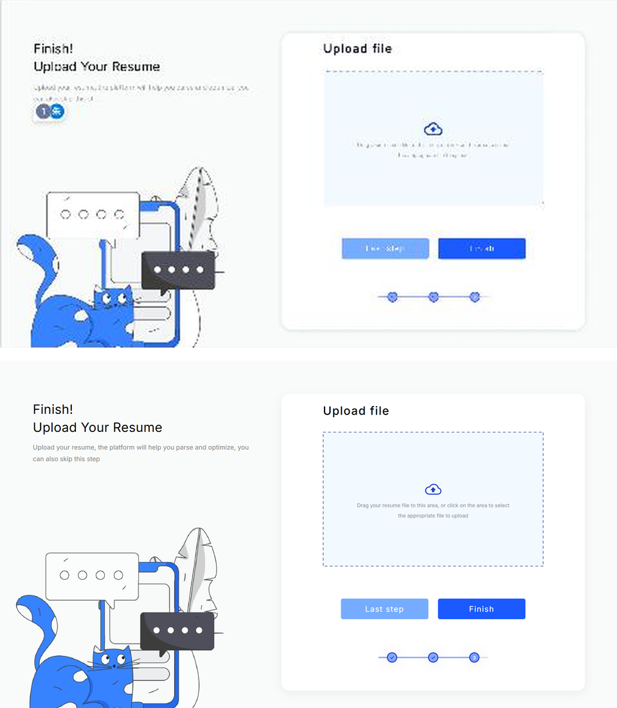

# 上传简历页：Figma 设计稿还原

还原"前端工程师（实习）"的 Figma 设计稿：引导流程的最后一步，用户上传简历或跳过。使用原生 **HTML + CSS + JavaScript** 编写，不依赖框架，也不需要构建。

```bash
# 直接打开
start index.html                # Windows（macOS：open index.html）
# 或者起一个本地服务（推荐，相对路径的行为与线上一致）
python -m http.server 5173      # 然后访问 http://localhost:5173
```

## 设计稿与实现对比



| 截图 | 文件 |
| --- | --- |
| 桌面 1920×1080 | [`screenshots/desktop_1920x1080.png`](screenshots/desktop_1920x1080.png) |
| 笔记本 1366×768（等比缩放） | [`screenshots/laptop_1366x768.png`](screenshots/laptop_1366x768.png) |
| 手机 390×844（上下堆叠布局） | [`screenshots/mobile_390x844.png`](screenshots/mobile_390x844.png) |
| 已选择文件 + 悬停在 "Finish" 按钮上 | [`screenshots/desktop_file_selected_hover.png`](screenshots/desktop_file_selected_hover.png) |

### 设计稿是怎么测量的

Figma 画框为 1920×1080。位置、尺寸和颜色是在 100% 和 200% 缩放下从画框中量取的。然后在 1920×1080 的无头浏览器中测量页面：

| 元素 | Figma（x, y, 宽×高） | 页面 | 偏差 |
| --- | --- | --- | --- |
| 卡片 | 876, 104, 944×922，圆角 24 | 876, 104, 944×922 | 0 |
| 虚线上传区 | 1004, 222, ≈686×418 | 1005, 222, 686×418 | ≤1 px |
| 上传图标 | 中心 ≈ (1348, 400)，56×36 | 1320, 382, 56×36（中心 1348, 400） | 0 |
| "Last step" / "Finish" | 1060 / 1364, 740, 272×64 | 1061 / 1363, 740, 272×64 | ≤1 px |
| 步骤条轨道 | 1175 → 1517，y 923 | 1177 → 1519，y 923 | 2 px |
| 标题 / 副标题 | 40/56 px 和 20/36 px，x 102 | 相同 | 0 |

颜色取自设计稿：页面背景 `#F9FBFA`，主色 `#1B5AFF`，次色 `#75ACFF`，拖放区 `#F2F9FF`，虚线边框 `#2B3A8C`，步骤圆点 `#82A9FF`、外圈 `#2A42C0`。

## 需求对照

**必做项**

- **页面结构与布局**：桌面端左右两栏（左侧是介绍文字和插画，右侧是上传卡片），按上面量取的 Figma 坐标定位。
- **视觉还原**：字号、颜色、按钮样式、图标位置、边框、阴影和圆角都与设计稿一致。
  - 拖放区的虚线边框用 SVG 背景实现，而不是 CSS `border: dashed`，因为 CSS 无法设置虚线的线段长度和间距。这样才能匹配设计稿中 9px/7px 的虚线。
  - 上传图标用 SVG 重新绘制：封闭的云朵轮廓加实心箭头。
- **语义化 HTML**：
  - `<main>`、两个分别以各自标题命名的 `<section>`，标题层级正确（`h1` → `h2`）。
  - 真正的 `<form>`，其中的 `<input type="file">` 通过 `<label>` 关联。
  - 步骤条是 `<nav>` 里的有序列表，当前步骤带 `aria-current="step"`。
  - 状态和错误提示使用 `role="status"` 和 `role="alert"`，屏幕阅读器会朗读。

**加分项**

- **点击上传**：整个虚线区域就是文件输入框的 `<label>`，点击，或者 Tab 聚焦后按 Enter / 空格，都会打开系统文件选择框。键盘聚焦时区域外会显示焦点环。
- **拖拽上传**：把文件拖到区域上方时高亮。文件掉在区域外面时，浏览器不会直接打开它。
- **按钮状态**：两个按钮都有悬停、按下和键盘聚焦（focus-visible）状态。"Finish" 在模拟请求期间显示加载状态。
- **响应式**：
  - 1024px 到 1920px 之间整体等比缩放：所有尺寸都写成 `N × --u`，其中 `--u = min(1px, 100vw / 1920)`。
  - 小于 1024px 时，从左右布局切换为上下布局：文字、插画、卡片依次排列。
- **显示已上传的文件名**：选择文件后显示一行信息，包括文件图标、文件名（过长时用省略号截断，悬停显示全名）、大小和删除按钮。
- **校验**：只接受 10 MB 以内的 `.pdf`、`.doc`、`.docx`，其他文件会在原位显示错误提示。

**提示中的"封装组件"**：上传逻辑封装成 `app.js` 中一个可复用的 `FileDropzone` 类，包含原生文件输入、拖拽、校验和文件名显示。它从 `data-` 属性读取限制条件，并派发 `dropzone:change` 事件，页面代码不需要接触它的内部实现。

## 说明

- **插画**（猫、手机和对话气泡）是从 Figma 画框以 200% 缩放截取的位图：两张截图拼接而成，并把纯色背景处理成透明（`assets/illustration.png`）。从 Figma 导出 SVG 会更清晰，但需要文件的编辑权限。
- **"1 朱"标记**：Figma 中副标题旁边的圆圈是 Figma 的评论标记，不属于设计内容，所以没有还原。
- **没有后端。** "Finish" 模拟提交请求并显示确认信息；没有选择文件时提示已跳过此步骤，与设计稿文案 "you can also skip this step" 对应。"Last step" 会返回浏览器历史的上一页。
- **浏览器支持**：最新版 Chrome、Edge、Firefox 和 Safari。页面用到了 CSS `min()`、`calc()` 和 `fit-content`。

## 文件

```text
index.html                 页面结构
styles.css                 样式（桌面端缩放 + 移动端布局）
app.js                     FileDropzone 组件和页面逻辑
assets/illustration.png    设计稿中的插画
screenshots/               页面截图和与 Figma 的对比图
```

## AI 使用情况

- **工具**：Claude Code（Anthropic，Claude Opus 5.5）。
- **AI 做了什么**：
  - 在浏览器中打开 Figma 文件，从放大的截图中量取位置和颜色。
  - 拼接插画位图。
  - 编写 HTML、CSS 和 JS。
  - 用无头 Chrome 截图并与设计稿对比。对比中发现了上传图标线条太细、虚线边框太粗、文件名被截断、手机端步骤条溢出等问题，都已修复。
- **哪些直接采用、哪些做了修改**：
  - **原样保留的三项决定**：①虚线边框用 SVG 背景（`styles.css` 第 136 行，`stroke-dasharray='9 7'`、线宽 3）而不是 `border: dashed`——CSS 的 dashed 无法指定线段长度与间距，换掉就还原不出设计稿 9/7 的节奏；②整体等比缩放靠 `--u: min(1px, calc(100vw / 1920))`（第 10 行），1024px 以上所有尺寸写成 `N × var(--u)`，我在 1920 宽下核对过卡片 `left: 876`、`width: 944`、`height: 922` 与坐标表一致；③插画用 Figma 200% 截图拼合并抠底，而不是导出 SVG——当时没有文件编辑权限，代价是放大后发虚，这点写进了上面"说明"。
  - **复核后保留的组件设计**：上传逻辑收进 `app.js` 的 `FileDropzone` 类，限制条件从 `data-max-mb="10"`、`data-accept=".pdf,.doc,.docx"` 读取，状态变化只抛 `dropzone:change` 事件（第 99 行），页面不碰它的内部实现。可复用的代价是页面与组件之间约定了一个字符串事件名。
  - **一处没改、但明确记录为取舍的地方**：重渲染时自动检查报出 "Last step" 按钮文字对比度 **2.31:1**，低于小字 4.5:1 的通用阈值。改配色会偏离设计稿，我选择保真，并在下面"我如何确认正确"里留档，而不是悄悄改掉或装作没看见。
  - **AI 初稿自查出、我对照截图复核后确认已修掉的问题**：上传图标线条过细、虚线边框过粗、文件名被截断、手机端步骤条溢出。
- **我如何确认正确**：
  1. **重渲染三档视口，逐像素比对**：用同一份代码在本机无头浏览器重拍，与仓库里的截图逐像素比较，**三份全部 0 差异**——1920×1080 为 0/2,073,600，1366×768 为 0/1,049,088，390×844（2 倍像素密度、整页）为 0/1,823,640。说明截图不是一次性的产物，换台机器也能复现。
  2. **自动检查**：无控制台错误、无横向溢出、图片全部加载成功；唯一告警是上面那处对比度。
  3. **按样式表核对坐标**：页面侧的数值能在 `styles.css` 里逐个找到（876/944/922、`--u` 的 min 公式、1024 断点、359px 以下的额外断点、`prefers-reduced-motion` 降级）。
  4. **人工走查（本人做）**：点击整块虚线区打开文件框、Tab 聚焦后按 Enter、拖入 PDF 成功、拖入 `.png` 看到 `role="alert"` 错误、选中后显示文件名/大小/删除按钮、窗口缩到 1023px 以下看上下堆叠、Finish 的加载态、文件名过长时确认省略号与悬停全名。
  5. **语义化逐项核对**：`aria-current="step"`、`role="status"`／`role="alert"`、`<label for="resume-input">` 关联文件输入——在 DOM 里逐个确认过，不只看"看起来对"。
